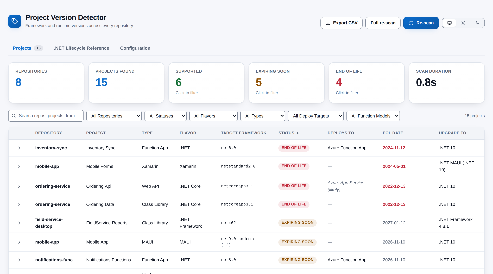
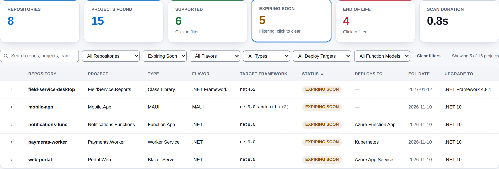
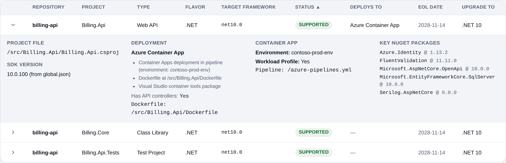
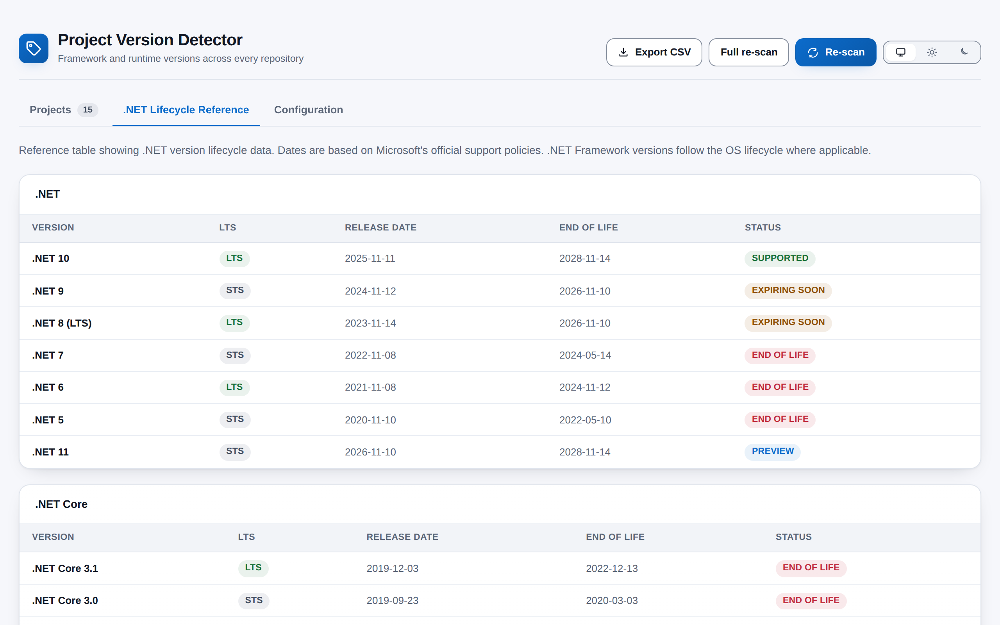
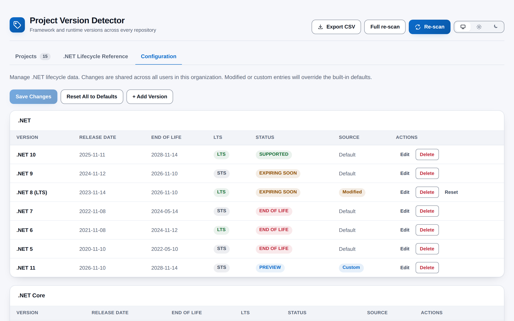

# Project Version Detector

[](https://github.com/adam-wheater/azure-devops-project-version-detector/actions/workflows/ci.yml)

Project Version Detector is an Azure DevOps extension for teams that own many .NET repositories and need to know which of them are running out of support. It scans every Git repository in the current project, reads each project file, and lists the target framework, .NET flavour, project type, Azure Functions and Container Apps details, key NuGet packages and where the project probably deploys. It then compares each target framework with Microsoft's lifecycle dates. It answers one question: **which of our projects are on a framework that is out of support, or soon will be, and what should they move to?** Everything runs in your browser, from a hub under **Repos > Version Detector**.



## Table of contents

- [Getting started](#getting-started)
- [Features](#features)
- [Screens](#screens)
  - [Projects tab](#projects-tab)
  - [.NET Lifecycle Reference tab](#net-lifecycle-reference-tab)
  - [Configuration tab](#configuration-tab)
- [How it works](#how-it-works)
- [Settings](#settings)
- [Rules and detection logic](#rules-and-detection-logic)
  - [Lifecycle status](#lifecycle-status)
  - [Built-in lifecycle data](#built-in-lifecycle-data)
  - [Files the scanner reads](#files-the-scanner-reads)
  - [Target framework and flavour](#target-framework-and-flavour)
  - [Project type](#project-type)
  - [Azure Functions](#azure-functions)
  - [MAUI and Xamarin](#maui-and-xamarin)
  - [Container Apps](#container-apps)
  - [Deployment target](#deployment-target)
  - [Key NuGet packages](#key-nuget-packages)
- [Scopes & permissions](#scopes--permissions)
- [Privacy](#privacy)
- [Troubleshooting and known limitations](#troubleshooting-and-known-limitations)
- [Development](#development)
- [Project structure](#project-structure)
- [Tech stack](#tech-stack)
- [Contributing](#contributing)
- [License](#license)

## Getting started

1. Install **Project Version Detector** by publisher `adam-wheater` from the Visual Studio Marketplace into your Azure DevOps organization (the listing carries the **Preview** flag). You need permission to read the project's repositories.
2. Open a project and go to **Repos > Version Detector**. The hub is contributed to the Repos hub group (`ms.vss-code-web.code-hub-group`, order 99), so it appears last in the Repos menu.
3. On first open there is no cached result, so a scan starts automatically and the progress bar fills as repositories finish. Later visits show your cached result straight away. A background incremental scan runs only when that result is more than 15 minutes old.
4. Read the table, which lists End of Life projects first. Click a status tile to filter, click a row for the project file, deployment evidence and key packages, or press **Export CSV** to download what you see.
5. Optionally review the dates on the **Configuration** tab. Changes there apply to everyone in the organization.

## Features

- **Project-wide scan:** lists every Git repository in the current project and reads its `.csproj`, `.fsproj` and `.vbproj` files, plus `global.json`, `Directory.Build.props`, `host.json` and pipeline YAML.
- **Lifecycle status per project:** each target framework is matched to Microsoft's dates and shown as End of Life, Expiring Soon (within six months), Supported or Preview, with the end-of-life date and a recommended upgrade target.
- **Incremental re-scans:** a repository whose default-branch head commit has not changed since the last scan is reused instead of being fetched again. Lifecycle statuses are still recalculated for today's date.
- **Deployment target inference:** web, API, worker and Functions projects get a "Deploys To" verdict (App Service, Container App, Function App, Static Web Apps or Kubernetes), marked as confirmed or *(likely)*, with the evidence behind it.
- **Azure Functions, Container Apps, MAUI and Xamarin details:** shows the hosting model and runtime, the Container Apps environment and workload profile, and flags Xamarin as end of life.
- **Clickable summary tiles and filters:** clicking a status tile filters the table. Free-text search covers repositories, projects, frameworks, file paths, deploy targets and key NuGet packages, and six drop-down filters narrow the list further.
- **CSV export:** downloads the projects you are currently looking at, with 22 columns.
- **Editable lifecycle data:** the Configuration tab lets you edit, add, remove and reset lifecycle entries. Changes are shared with everyone in the organization through the Extension Data Service.
- **Per-user, per-project scan cache:** the last result opens instantly. If it is less than 15 minutes old, no background scan starts.
- **Cancellable scans:** **Cancel** aborts every pending REST call through one `AbortSignal`. The scan also stops when you leave the page.
- **Resilient to throttling:** HTTP 429, 502, 503 and 504 responses and network errors are retried with exponential backoff and jitter. Repositories are scanned 8 at a time and files are fetched 20 at a time.
- **Theme follows Azure DevOps:** light, dark and high contrast follow your Azure DevOps theme automatically. A header toggle lets you pin light or dark, and it is hidden under high contrast.
- **WCAG 2.1 AA contrast:** both palettes are audited (4.5:1 for text, 3:1 for UI boundaries). Status is always written as text, never shown by colour alone.

## Screens

The hub has three tabs: **Projects**, **.NET Lifecycle Reference** and **Configuration**. Each is described below.

### Projects tab

The tab label shows the number of projects found. Until the first scan finishes it shows the progress bar. If no scan is running and there is no result yet, it shows "No scan results yet" with a prompt to press **Re-scan**.

#### Header actions

| Control | When shown | What it does |
|---------|------------|--------------|
| **Export CSV** | A result exists | Downloads the projects currently shown (after filters) as `version-report-YYYY-MM-DD.csv`, dated by your local calendar day. |
| **Full re-scan** | A result exists and no scan is running | Scans every repository from scratch, ignoring the previous result. |
| **Re-scan** (primary) | No scan is running | Incremental scan: unchanged repositories are reused. |
| **Cancel** (danger) | A scan is running | Aborts the scan. A "Scan cancelled." banner follows. |
| Theme toggle | Not in high contrast | Azure DevOps / Light / Dark. |

#### Banners and progress

- **Last scanned** (info): shown while the displayed result came from the cache. It shows the local date and time, followed by ". Refreshing..." during a scan or ". Click Re-scan for fresh results" otherwise.
- **Stale lifecycle data** (warning, dismissible): shown when any built-in entry's stored status no longer matches the status calculated for today. It links to the Configuration tab and to Microsoft's .NET support policy page.
- **Errors** (error): "No repositories found in this project." or the message of the failure that stopped the scan. "Scan cancelled." uses the neutral info style.
- **Progress:** a `role="progressbar"` bar labelled "Scanning repositories - <last repository finished>", with `current / total` repositories. Before the repository list arrives it is indeterminate and reads "Initializing...".
- **Incremental note:** "Incremental scan: N of M repositories were unchanged since the last scan and were reused."

#### Summary tiles



| Tile | Value | Clickable |
|------|-------|-----------|
| Repositories | Repositories in the project (`summary.totalRepos`) | No |
| Projects Found | Project files with a recognised target framework | No |
| Supported | Projects whose status is Supported or Current | Yes: filters to **Supported** |
| Expiring Soon | Projects whose status is Expiring Soon | Yes: filters to **Expiring Soon** |
| End of Life | Projects whose status is End of Life | Yes: filters to **End of Life** |
| Scan Duration | Wall-clock scan time in seconds, one decimal place | No |

A clickable tile is a toggle button (`aria-pressed`). Clicking it again clears the filter. The active tile gets an accent ring and its hint text changes from "Click to filter" to "Filtering: click to clear", so the state is never shown by colour alone. Preview projects are counted in Projects Found but have no tile of their own.

#### Filter toolbar

- **Search** (debounced 250 ms): matches repository name, project name, target framework, project file path, deployment target and key NuGet package names. Matching is case-insensitive.
- **Drop-downs:** Repository, Status, Flavor and Type are always shown. Deploy Target and Function Model appear only when at least one project has a value for them. Options are built from the current result. Function models are listed in the order they were found, and the other options are sorted alphabetically.
- **Clear filters** appears when any filter is active and resets all of them.
- The live count reads "Showing X of Y projects" when filtered, or "Y projects" otherwise.

#### Project table

Sortable columns are marked with `aria-sort`, and each header is a button that also works from the keyboard. Clicking the active column toggles between ascending and descending. The default sort is Status, ascending (End of Life first).

| Column | Content | Sort |
|--------|---------|------|
| (toggle) | Expand or collapse the detail row (`aria-expanded`). Clicking anywhere on the row also toggles it. | - |
| Repository | Repository name | Alphabetical |
| Project | Project file name without extension | Alphabetical |
| Type | Project type (see [Project type](#project-type)) | Alphabetical |
| Flavor | .NET, .NET Core, .NET Framework, .NET Standard, MAUI, Xamarin or Unknown | Alphabetical |
| Target Framework | Primary (first) target framework, with "(+N)" when the project multi-targets | Framework generation (Xamarin, .NET Framework, .NET Standard, .NET Core, .NET), then version, so `net472` < `net48` < `netcoreapp3.1` < `net8.0` < `net10.0` |
| Status | Lifecycle pill: END OF LIFE (danger), EXPIRING SOON (warning), SUPPORTED (success), CURRENT (info), PREVIEW (accent), UNKNOWN (neutral). The tooltip explains each one. | End of Life, Expiring Soon, Supported, Current, Preview |
| Deploys To | Deployment target. *Likely* verdicts are italic and followed by "(likely)". The tooltip lists the evidence. "-" if there is none. | Alphabetical |
| EOL Date | End-of-life date, "Supported with OS lifecycle", "N/A (.NET Standard)" or "Unknown". A date that has passed is bold in the danger colour, with hidden "(passed)" text for screen readers. | - |
| Upgrade To | Recommended target: `.NET 10` for modern .NET and .NET Core, `.NET Framework 4.8.1` for .NET Framework, `.NET MAUI (.NET 10)` for Xamarin | - |

When filters match nothing, the table is replaced by "No projects match the current filters."

#### Project details



An expanded row shows up to four sections:

- **Project File:** the full path, the SDK version from `global.json` if there is one, and all target frameworks when the project multi-targets.
- **Deployment:** the target, "(likely, inferred)" when inferred, the evidence list, whether the project has API controllers, and the Dockerfile path.
- **Azure Function / Container App:** the hosting model and runtime version, then the Container Apps environment, whether it uses a workload profile, and the pipeline file.
- **Key NuGet Packages:** `name @ version` for each [key package](#key-nuget-packages).

#### CSV export

The file holds one row per project currently shown, with these columns: Repository, Project File, Project Name, Project Type, .NET Flavor, Target Framework, All Target Frameworks, SDK Version, Lifecycle Status, EOL Date, Latest LTS, Function App Model, Function Runtime Version, Deployment Target, Deployment Confidence, Deployment Evidence, Dockerfile, Has Controllers, Container App Environment, Has Workload Profile, Pipeline File and Key NuGet Packages. Lists inside a cell are joined with `; `. A field containing a comma, quote, CR or LF is quoted. A field starting with `=`, `+`, `-`, `@`, tab or CR is prefixed with `'`, so a spreadsheet does not run it as a formula.

### .NET Lifecycle Reference tab



This tab is read-only. It shows one card per framework family (.NET, .NET Core, .NET Framework, Xamarin, Xamarin.iOS, Xamarin.Android) listing the lifecycle data currently in effect, which means built-in data plus any saved configuration.

| Column | Content |
|--------|---------|
| Version | Display name |
| LTS | **LTS** pill (success) or **STS** pill (neutral) |
| Release Date | `YYYY-MM-DD` |
| End of Life | `YYYY-MM-DD`, or "OS lifecycle" when there is no fixed date |
| Status | Status calculated for today (see [Lifecycle status](#lifecycle-status)) |

### Configuration tab



The Configuration tab edits the lifecycle data for **everyone in the organization**. Changes stay local until you press **Save Changes**.

- **Toolbar:** **Save Changes** (enabled only when there are unsaved changes, and shows "Saving..." while busy), **Reset All to Defaults**, **+ Add Version** / **Cancel**, and an "Unsaved changes" warning pill.
- **Add a version:** Framework, Version, Display Name, Release Date, End of Life and LTS. Framework, Version and Display Name are required and are trimmed. If an entry with the same framework and version already exists, the form says "<framework> <version> is already in the list. Edit that entry instead."
- **Table per framework:** Version, Release Date, End of Life, LTS, Status, Source and Actions. Source is a **Custom** pill (info), a **Modified** pill (warning) or "Default".
- **Row actions:**
  - **Edit** switches the row to inputs (display name, release date, end-of-life date, LTS). **Save** applies the change locally; **Cancel** discards it.
  - **Delete** removes a custom entry immediately. A built-in entry first opens a "Remove built-in entry?" dialog.
  - **Reset** (modified built-in entries only) restores the shipped values.
- **Reset All to Defaults** opens a confirmation dialog first. It then deletes the stored document, so custom entries are removed too.
- Success ("Configuration saved.", "Reset to defaults.") and failure ("Failed to save: ...") messages appear in a dismissible banner.

Saving replaces the active lifecycle data straight away and starts an incremental re-scan. That re-scan reuses unchanged repositories and only recalculates their statuses.

## How it works

```
 Repos > Version Detector
          |
          v
 SDK.init() -> SDK.ready()                        azure-devops-extension-sdk
          |
          v
 ProjectPageService.getProject() -> { id, name }
          |
          +--> ExtensionDataService  LifecycleSettings / "lifecycle-config"   (org-wide)
          +--> ExtensionDataService  ScanCache / "scan-result-cache-<id>"     (User scope)
          |
          v
 GitRestClient.getRepositories(project)
          |
          v  8 repositories at a time (ConcurrencyLimiter)
 +----------------------------------------------------------------------+
 | getBranch(repo, defaultBranch) -> head commit                         |
 |   same head as the previous scan? -> reuse its projects, recompute    |
 |                                      lifecycle, skip the rest         |
 | getItems(repo, "/", Full recursion) -> file tree                      |
 | discoverFiles(): project / config / Functions / pipeline files,       |
 |   plus Dockerfile, compose, Kubernetes, Controllers, .razor paths     |
 | getItemContent() for each file, 20 at a time, skip files over 1 MB    |
 | pipeline template: references followed up to 5 levels deep           |
 | detectors -> DetectedProject[]                                        |
 +----------------------------------------------------------------------+
          |
          v
 summary + sort (status, then repository) -> UI
          |
          v
 ScanCache document saved (User scope)
```

1. **Start-up.** `src/VersionHub/VersionHub.tsx` calls `SDK.init()` and then `SDK.ready()`, and renders `<App/>` inside the `ThemeProvider`. If the SDK cannot connect, the page shows the error text instead.
2. **Project context.** `RepoService` reads the current project's id and name from `ProjectPageService`. The id namespaces the scan cache, because Extension Data Storage is organization-wide.
3. **Saved state.** `LifecycleConfigService.loadConfig()` reads the shared lifecycle overrides and merges them with the built-in data. `ScanCacheService.loadCachedScanResult()` restores your last result for this project. A result younger than 15 minutes skips the automatic scan.
4. **Repositories.** `GitRestClient.getRepositories(projectName)` returns every repository in one call (the API does not page this list).
5. **Per repository**, with at most 8 running at once:
   - `getBranch(repoId, defaultBranch)` gives the head commit. If it equals the head stored with the previous result, the previous projects are reused.
   - `getItems(repoId, "/", undefined, Full)` lists the whole tree. If this call fails, the repository is reported as failed (logged to the browser console) and its head is **not** recorded, so the next scan tries it again.
   - Matching files are fetched with `getItemContent`, at most 20 at a time per repository. Files larger than 1 MB, and files that cannot be read, are skipped.
   - The detectors described under [Rules and detection logic](#rules-and-detection-logic) produce one `DetectedProject` per project file.
6. **Retries and cancellation.** Every REST call goes through `retryWithBackoff`: up to 4 attempts, a 500 ms base delay doubling each time, with ±25% jitter, for 429/502/503/504 and network errors. **Cancel** aborts the shared `AbortController`. Queued work then returns immediately and in-flight backoffs end early.
7. **Result.** Projects are sorted by status (End of Life first) and then by repository name. Counts are summarised, and the result is saved to the `ScanCache` collection in **User** scope as document `scan-result-cache-<projectId>`. Each result records the head commit of every repository it scanned successfully (`repoCommits`) and a scanner schema version. A result from a different scanner version is never used for incremental reuse.

## Settings

The lifecycle configuration is the only stored setting. It lives in the Extension Data Service, collection `LifecycleSettings`, document `lifecycle-config`, in the default (organization-wide) scope.

| Setting | Default | Validation | Effect |
|---------|---------|------------|--------|
| Lifecycle entry: display name | Built-in name | Required when adding | Label in both lifecycle tables |
| Lifecycle entry: release date | Built-in date | Date picker (`YYYY-MM-DD`) | With an end-of-life date more than six months away, a release date after today makes the status **Preview** |
| Lifecycle entry: end-of-life date | Built-in date, or empty | Date picker; empty means "OS lifecycle" | Drives End of Life / Expiring Soon for every project on that framework |
| Lifecycle entry: LTS | Built-in flag | Checkbox | LTS/STS pill only |
| Custom entry: framework + version | - | Required. Must not duplicate an existing framework/version pair. Must match the parsed form (for example `.NET` + `11.0`, or `.NET Framework` + `4.8.1`) to apply to projects. | Adds a lifecycle row that projects can match |
| Removed built-in entries | None | Built-in entries ask for confirmation | Projects on a removed framework get **End of Life / Unknown** |
| Theme | Follow Azure DevOps | Azure DevOps / Light / Dark | Stored only in this browser's `localStorage` under `project-version-detector.theme` |

The stored document looks like this: `{ id, lastUpdated, overrides: { "<framework>|<version>": { framework, version, displayName, releaseDate, endOfLifeDate, isLts, isCustom } }, deletedDefaults: ["<framework>|<version>"] }`. Only modified and custom entries are written. Loading tolerates missing or malformed fields.

These limits are fixed in code and cannot be changed in the UI:

| Limit | Value | Where |
|-------|-------|-------|
| Repositories scanned at once | 8 | `REPO_CONCURRENCY` in `src/scanning/Constants.ts` |
| File reads at once (per repository) | 20 | `FILE_CONCURRENCY` |
| Largest file read | 1 MB | `MAX_FILE_SIZE` |
| Pipeline template depth | 5 levels | `ScanOrchestrator` |
| Retry attempts / base delay | 4 / 500 ms (doubling, ±25% jitter) | `retryWithBackoff` |
| Cache age that skips the automatic scan | 15 minutes | `CACHE_FRESH_THRESHOLD_MS` in `App.tsx` |
| "Expiring Soon" window | 6 calendar months | `computeStatus` |

## Rules and detection logic

### Lifecycle status

The status is calculated for today's date every time a scan runs, including the incremental scan that starts when you open the page with a result older than 15 minutes, and every time the lifecycle tables are drawn. A framework therefore moves to Expiring Soon or End of Life on its own, with no new commit needed. Dates are compared as **calendar days in your local time zone**. The end-of-life date is the last day of support, so the verdict changes at local midnight for everyone and does not depend on the viewer's offset from UTC.

| Status | Condition (checked in this order) | Pill |
|--------|-----------------------------------|------|
| Supported | No end-of-life date (OS lifecycle) | SUPPORTED, success |
| End of Life | The end-of-life date is before today | END OF LIFE, danger |
| Expiring Soon | The end-of-life date is within the next 6 calendar months (clamped at month end, so 31 Aug + 6 months = 28 Feb) | EXPIRING SOON, warning |
| Preview | The release date is after today | PREVIEW, accent |
| Supported | Otherwise | SUPPORTED, success |

Special cases:

- A target framework that cannot be parsed, or a version missing from the lifecycle data, is treated as **End of Life** with an EOL date of "Unknown". This deliberately errs on the cautious side.
- **.NET Standard** versions missing from the data are **Supported** with "N/A (.NET Standard)".
- **Xamarin** projects are always End of Life (2024-05-01), whatever their target framework says.
- The stale-data warning appears when the newest .NET version in the built-in data was released more than 13 months ago, which means a newer major version has shipped that the data does not list. Add it on the Configuration tab.

To tune the rules, edit the dates in the [Configuration tab](#configuration-tab). A later end-of-life date moves projects out of End of Life, and deleting an entry makes its projects End of Life / Unknown.

### Built-in lifecycle data

| Family | Version | LTS | Release | End of life |
|--------|---------|-----|---------|-------------|
| .NET | 10 | LTS | 2025-11-11 | 2028-11-14 |
| .NET | 9 | STS | 2024-11-12 | 2026-11-10 |
| .NET | 8 | LTS | 2023-11-14 | 2026-11-10 |
| .NET | 7 | STS | 2022-11-08 | 2024-05-14 |
| .NET | 6 | LTS | 2021-11-08 | 2024-11-12 |
| .NET | 5 | STS | 2020-11-10 | 2022-05-10 |
| .NET Core | 3.1 / 3.0 / 2.1 / 2.0 / 1.1 / 1.0 | LTS / STS / LTS / STS / STS / LTS | 2016-2019 | 2018-10-01 to 2022-12-13 (all passed) |
| .NET Framework | 4.8.1, 4.8, 4.7.2, 4.7.1, 4.7, 3.5 | - | 2008-2022 | OS lifecycle |
| .NET Framework | 4.6.2 | - | 2016-08-02 | 2027-01-12 |
| .NET Framework | 4.6.1, 4.6, 4.5.2 | - | 2014-2015 | 2022-04-26 |
| .NET Framework | 4.5.1, 4.5, 4.0 | - | 2010-2014 | 2016-01-12 |
| Xamarin, Xamarin.iOS, Xamarin.Android | 5.0, 4.0, 16.0, 13.0 | - | 2019-2022 | 2024-05-01 |

.NET 9's end of support is 10 November 2026 because Microsoft extended Standard Term Support from 18 to 24 months. The latest LTS used for upgrade advice is `.NET 10`.

### Files the scanner reads

| Category | Pattern (case-insensitive) | Content fetched |
|----------|----------------------------|-----------------|
| Project files | `*.csproj`, `*.fsproj`, `*.vbproj` | Yes |
| Config files | `global.json`, `Directory.Build.props`, `Directory.Packages.props`, `nuget.config`, `packages.config` | Yes |
| Functions files | `host.json`, `local.settings.json` | Yes |
| Pipelines | `azure-pipelines.y(a)ml`, anything under `.azure-pipelines/`, `pipelines/` or `.pipelines/`, and `build`, `deploy`, `stage`, `infrastructure`, `release`, `ci` or `cd` `.y(a)ml` | Yes, plus `template:` references up to 5 levels |
| Dockerfiles | `Dockerfile`, `Dockerfile.*`, `*.Dockerfile` | Path only |
| Compose | `docker-compose*.y(a)ml`, `compose*.y(a)ml` | Path only |
| Kubernetes | `*.y(a)ml` under `k8s/`, `kubernetes/`, `charts/`, `helm/`, `manifests/` | Path only |
| Controllers | `*.cs` directly inside a `Controllers/` folder | Path only |
| Razor | `*.razor` | Path only |

A repository with no project files skips the .NET detectors and contributes no rows.

### Target framework and flavour

| Source | Rule |
|--------|------|
| `<TargetFrameworks>` | Split on `;`. The first one is the primary target framework. |
| `<TargetFramework>` | Single target framework |
| `<TargetFrameworkVersion>v4.7.2</...>` | Legacy project: becomes `net472` |
| Nearest `Directory.Build.props` | Used when the project file names no target framework. The props file must be in the project's folder or an ancestor. Values that are still MSBuild properties (`$(...)`) are ignored. |
| None of the above | The project file is skipped |

| Moniker | Framework / flavour |
|---------|---------------------|
| `net5.0` and later (also `net8.0-windows`) | .NET |
| `net6.0-android`, `-ios`, `-maccatalyst`, `-tizen` | .NET (lifecycle) / MAUI (flavour) |
| `netcoreappX.Y` | .NET Core |
| `net35` to `net481` | .NET Framework |
| `netstandardX.Y` | .NET Standard |
| `monoandroid*`, `xamarin.ios*`, `xamarin.mac*` | Xamarin |

The SDK version shown comes from `sdk.version` in the repository's `global.json` and applies to every project in that repository.

### Project type

`<PackageReference>` items are read whatever order their attributes are in. Central Package Management references with no version count as well and are listed with the version "(central)". The first matching rule wins:

| Order | Type | Rule |
|-------|------|------|
| 1 | MAUI | `<UseMaui>true</UseMaui>` or a `Microsoft.Maui*` package |
| 2 | Xamarin | `Xamarin.Forms`, `Xamarin.Essentials`, `Xamarin.Android*` or `Xamarin.iOS*` package |
| 3 | Function App | `Microsoft.Azure.Functions.Worker`, `...Worker.Sdk` or `Microsoft.NET.Sdk.Functions` |
| 4 | Test Project | `Microsoft.NET.Test.Sdk`, `xunit`, `NUnit` or `MSTest.TestFramework`, or `<IsPackable>false</IsPackable>` |
| 5 | Blazor WebAssembly | `Microsoft.AspNetCore.Components.WebAssembly` |
| 6 | Blazor Server | `...Components.WebAssembly.Server` or `...Components` with the Web SDK |
| 7 | Worker Service | `Microsoft.Extensions.Hosting` with the Worker SDK |
| 8 | Web API / Web App | Web SDK: Web API with `Swashbuckle.AspNetCore` or `Microsoft.AspNetCore.OpenApi`, otherwise Web App |
| 9 | WPF / WinForms | `<UseWPF>true</UseWPF>` / `<UseWindowsForms>true</UseWindowsForms>` |
| 10 | Console | `<OutputType>Exe</OutputType>` |
| 11 | Class Library | `<OutputType>Library</OutputType>` or any `Microsoft.NET.Sdk` |
| - | Unknown | Nothing matched |

Two refinements come from the repository tree. A Web App with `.razor` files is re-classified as **Blazor Server**, and one with a `Controllers/` folder as **Web API**.

### Azure Functions

| Field | Rule |
|-------|------|
| Model | **Isolated Worker** if a `Microsoft.Azure.Functions.Worker`, `...Worker.Sdk` or `...Worker.Extensions.Http.AspNetCore` reference exists, otherwise **In-Process** if `Microsoft.NET.Sdk.Functions` is referenced |
| Runtime | `<AzureFunctionsVersion>` if set. Otherwise inferred from the target framework (`v4 (.NET N)` for any .NET 5+ major, `v4 (.NET Framework)` for `net4x`), falling back to `v4 (Isolated)` / `v4 (In-Process)`. With a `host.json`, the runtime is prefixed `v<host.json version> runtime - ...`. |

### MAUI and Xamarin

- **MAUI:** `<UseMaui>true</UseMaui>`, `Sdk="Microsoft.NET.Sdk.Maui"`, a `Microsoft.Maui*` reference, or a `net6.0`+ target with an `-android`, `-ios`, `-maccatalyst` or `-tizen` suffix. A `-windows` suffix alone does not count, because WPF and WinForms on modern .NET use it too. The project type and flavour become MAUI.
- **Xamarin:** `Xamarin.Forms` or `Xamarin.Essentials` references, the Xamarin.Android, iOS or Mac project-type GUIDs, `Xamarin.Android` / `Xamarin.iOS` imports, or `monoandroid` / `xamarin` target frameworks. The flavour becomes Xamarin, the status End of Life (2024-05-01), and the upgrade target `.NET MAUI (.NET 10)`.

### Container Apps

A pipeline file counts as a Container Apps deployment when it has an `AzureContainerApps@N` task, an `az containerapp create|update|deploy|up` command, or a `containerAppName:` key.

- **Environment:** taken from `containerAppEnvironment:`, `containerapp-environment:`, `CONTAINER_APP_ENVIRONMENT:`, `environmentName:`, `managedEnvironmentId:` or `--environment`. `$(var)` becomes `[Variable: var]` and `${{ parameters.x }}` becomes `[Parameter: x]`. Without any of these the environment is "Unknown".
- **Workload profile:** any `workload-profile`, `workload_profile` or `workloadprofile` text in any pipeline file of the repository.
- **Image:** `imageToDeploy:`, `containerImage:`, `image:` or `--image`.
- **Correlation:** the deployment is assigned to projects whose name appears in the pipeline YAML or image. If none do, it goes to every deployable project (not test projects or class libraries) in the same repository. Pipeline files are also analysed merged together, so parameters and tasks split across templates are seen together.

### Deployment target

Only Web App, Web API, Blazor, Worker, Console, Function App and Container App projects get a verdict. The first matching rule wins. "Named" means the project name appears in the pipeline YAML, or it is the only deployable project in the repository.

| Order | Target | Confidence | Trigger |
|-------|--------|------------|---------|
| 1 | Azure Function App | confirmed | Functions package in the project (evidence adds the Function App deploy task when named) |
| 2 | Azure Container App | confirmed | Correlated Container Apps deployment (see above), or a Container Apps task/CLI plus named plus containerised |
| 3 | Azure Static Web Apps | confirmed | `AzureStaticWebApp@N` / `az staticwebapp` plus a Blazor WebAssembly project |
| 4 | Azure App Service | confirmed | `AzureWebApp@N`, `AzureRmWebAppDeployment@N`, `AzureWebAppContainer@N`, `appType: webAppContainer` or `az webapp deploy|create|up`, plus named |
| 5 | Kubernetes | confirmed with a `KubernetesManifest`/`HelmDeploy`/`Kubernetes` task, `kubectl apply` or `helm upgrade|install`; likely with manifests only | Containerised plus Kubernetes signals |
| 6 | Azure Container App | likely | Containerised, with no platform identified |
| 7 | Azure App Service | likely | Web-shaped (Web App, Web API, Blazor) or has controllers, with no container signals |
| - | (none) | - | Workers and consoles with no signals |

"Containerised" means either of two things. The first is an associated Dockerfile: one under the project's folder, else one whose path contains the project name, else the repository's first Dockerfile when the project is the only one in the repository. The second is container tooling in the project file: `Microsoft.NET.Build.Containers`, `Microsoft.VisualStudio.Azure.Containers.Tools.Targets`, `<EnableSdkContainerSupport>true`, `<DockerfileFile>` or `<DockerfileContext>`. Each verdict's evidence is listed in the details panel and in the CSV export.

### Key NuGet packages

Only packages whose names start with one of these prefixes (case-insensitive) are kept: `Microsoft.AspNetCore`, `Microsoft.EntityFrameworkCore`, `Microsoft.Extensions`, `Microsoft.Azure.Functions`, `Microsoft.NET.Sdk`, `Microsoft.Maui`, `Xamarin`, `System.Text.Json`, `Newtonsoft.Json`, `Swashbuckle`, `Polly`, `MediatR`, `AutoMapper`, `FluentValidation`, `Serilog`, `NLog`, `Dapper`, `Grpc`, `Microsoft.Identity`, `Azure.`. To change the list, edit `getKeyPackages` in `src/scanning/detectors/NuGetPackageDetector.ts`.

## Scopes & permissions

| Scope | Used for |
|-------|----------|
| `vso.code` (Code, read) | `GitRestClient.getRepositories`, `getBranch` (default-branch head commit), `getItems` (full tree), `getItemContent` (file contents) |
| `vso.extension.data` (Extension data, read and write) | `ExtensionDataService` `getDocument` / `setDocument` / `deleteDocument` for `LifecycleSettings` (organization-wide) and `ScanCache` (User scope) |

Both scopes are used, and the extension requests nothing else. It never writes to repositories. Reading the project context through `ProjectPageService` needs no scope. Each user only sees repositories they can already read.

## Privacy

- Everything runs in your browser inside the Azure DevOps extension frame, using your own signed-in session. A user can only scan repositories they can already read.
- The extension stores two things, both in your organization's Azure DevOps Extension Data Service:
  - **Your last scan result** for each project: collection `ScanCache`, document `scan-result-cache-<projectId>`, **User** scope, so only you can read it. It contains repository and project names, file paths, target frameworks, key package names and versions, deployment evidence and the head commit ids of the repositories it scanned. No file contents are stored.
  - **The lifecycle configuration**: collection `LifecycleSettings`, document `lifecycle-config`, shared by the organization.
- Your theme choice is kept in this browser's `localStorage` (`project-version-detector.theme`).
- There is no telemetry and no analytics, and the extension makes no calls to any service other than your Azure DevOps organization. The only external link is to Microsoft's .NET support policy page, and it opens only when you click it.

## Troubleshooting and known limitations

- **Only .NET projects are detected.** A repository with no `.csproj`, `.fsproj` or `.vbproj` file (Node, Python, Java and so on) adds no rows, although it still counts in the **Repositories** tile.
- **A repository shows no projects.** Its project files may name no target framework and inherit it from something other than a `Directory.Build.props` in an ancestor folder (for example an imported `.props` file with another name), or use an unresolved MSBuild property. Projects in disabled or empty repositories are also absent. Tree-fetch failures are logged to the browser console and retried on the next scan.
- **A single unreadable file.** Individual file reads that fail after retries, or files over 1 MB, are skipped without a message. The repository's head commit is still recorded, so an incremental scan keeps the partial result until the next commit. Use **Full re-scan** if you suspect this.
- **"Current" never appears.** The status exists in the data model and has a pill, but the status calculation never assigns it. The newest versions show as Supported. Likewise the framework, type and flavour breakdowns in the summary are calculated but not shown.
- **Unknown frameworks are End of Life.** Unrecognised monikers and versions missing from the lifecycle data are treated as End of Life with an EOL date of "Unknown". Add the version on the Configuration tab if it is real.
- **Built-in dates are a snapshot.** The data ships with the extension. The stale-data banner appears once the newest built-in .NET release is over 13 months old, and you can correct dates on the Configuration tab without waiting for an update.
- **Lifecycle configuration is last-write-wins.** Two administrators saving at the same time overwrite each other. There is no merge.
- **Cache size.** The Extension Data Service limits document size. If a very large result cannot be cached, the save fails quietly (a console warning) and the next visit scans again.
- **Pipeline templates in other repositories** (`template: x.yml@other-repo`) are not read from that repository. The `@other-repo` suffix is dropped and the path is looked up in the current repository, where it is usually not found. Templates are resolved up to 5 levels deep.
- **Central Package Management versions** are not resolved into projects. Such references are listed as "(central)".
- **Deployment targets are inferred.** *Likely* verdicts are educated guesses from repository shape, so check the evidence list before relying on them.
- **High contrast detection is a heuristic** based on pure black and white host colours and OS forced colours. The theme toggle hides itself when high contrast is detected.

## Development

### Prerequisites

- Node.js 20 or later (`engines.node >= 20`) and npm.
- Install with `npm ci --legacy-peer-deps`. The flag is required for the Azure DevOps SDK and React 18 peer ranges, and CI uses it too.

### npm scripts

| Script | What it does |
|--------|--------------|
| `npm run build` | Production webpack build into `dist/`; `postbuild` runs `scripts/verify-bundle.js`, then `scripts/third-party-notices.js`. |
| `npm run build:dev` | Development build with source maps (CSS is still extracted to a file). |
| `npm run screenshots` | Builds the hub on sample data and saves the screenshots to `static/screenshots/` (see below). |
| `npm run verify:bundle` | Re-checks an existing `dist/` without rebuilding. |
| `npm run package` | `tfx extension create` into `out/*.vsix`. |
| `npm test` | Jest, both projects, verbose. |
| `npm run test:watch` | Jest in watch mode. |
| `npm run lint` / `npm run lint:fix` | ESLint flat config (`eslint.config.js`) over `src/**/*.{ts,tsx}` and `tests/**/*.{ts,tsx}`. |
| `npm run format` / `npm run format:check` | Prettier over the same globs. |
| `npm run publish:marketplace` | `tfx extension publish` with `vss-extension.json`. |

Every script quotes its globs with double quotes. `cmd.exe` does not strip single quotes, so single-quoted globs break on Windows.

### Run it locally with sample data

`demo/` builds the real hub against stand-ins for the Azure DevOps SDK and REST clients, filled with a fictional "Contoso" project of eight .NET repositories. The hub scans their project files, pipelines and `global.json` with its real detectors, so the sample has projects that are supported, expiring soon and past end of life. Use it to try the UI without an organization, and to refresh the screenshots:

```sh
npm i --no-save playwright && npx playwright install chromium   # once
npm run screenshots
```

After that, open `demo/dist/VersionHub/VersionHub.html` in a browser to click around. `demo/api.ts` holds the sample repositories and `demo/shots.json` lists the screenshots; the other files in `demo/` are the same in every extension. Nothing in `demo/` ships in the package.

### `build.ps1`

`build.ps1` is the same script in every extension repository (it reads the product name from `vss-extension.json`). It runs the CI steps locally, in CI order:

1. **Install:** `npm ci --legacy-peer-deps --no-audit --no-fund`, the same install as `ci.yml`.
2. **Lint:** `npm run lint`.
3. **Format check:** `npm run format:check`.
4. **Tests:** `npm test`.
5. **Version:** bumps the patch version (for example 1.0.9 to 1.0.10) in `vss-extension.json`, `package.json` and both root entries of `package-lock.json`. If a later step fails, all three files are restored.
6. **Build:** `npm run build`, including bundle verification.
7. **Package:** `npm run package`. The script then checks that `out/adam-wheater.project-version-detector-<version>.vsix` exists and fails if it does not.

Before step 2 it also checks that `package.json` defines every script it calls.

| Parameter | Effect |
|-----------|--------|
| `-Version 1.1.0` | Releases exactly this version instead of the patch bump. |
| `-NoBump` | Packages the current version unchanged. Cannot be combined with `-Version`. |
| `-SkipInstall` | Reuses the existing `node_modules`. |
| `-SkipTests` | Skips `npm test`. |
| `-SkipChecks` | Skips lint and format check. CI still enforces both. |

The committed version is 1.0.0. `.github/workflows/ci.yml` runs the same install, lint, format check, tests, build, bundle verification and packaging on Node 20, then uploads the `.vsix` as an artifact.

### Tests

`jest.config.js` defines two projects. They share one `moduleNameMapper`: the `@/` alias, CSS mapped to `tests/__mocks__/styleMock.js`, and the SDK and API mapped to `tests/__mocks__`. Coverage thresholds (50% branches, 60% functions, lines and statements) apply to `jest --coverage`.

- **unit** (`testEnvironment: node`) covers everything under `tests/` except `tests/components/`:
  - every detector, `FileDiscovery`, `FileContentFetcher` and `ScanOrchestrator`, including incremental reuse, the rule that a failed repository never records its head commit, and schema-version invalidation;
  - `DotNetLifecycle`: parsing, calendar-day status at the EOL boundary, month-end clamping, built-in data and the target framework ordering;
  - `dates`, `retryWithBackoff` (including listener cleanup), `ConcurrencyLimiter`, `csvExport` (quoting and formula neutralising), `csvDownload` (jsdom), `RepoService`, `ScanCacheService` and `LifecycleConfigService`;
  - **guard tests** in `tests/repo/`. `npmScripts.test.ts` checks that no npm script single-quotes an argument and that every script `build.ps1` and CI call is defined. It also checks that `build.ps1` and `ci.yml` both install with `npm ci --legacy-peer-deps`, that `build.ps1` is ASCII-only, and that it has no trailing whitespace after a line-continuation backtick. `packageContents.test.ts` checks that no `.svg` file sits under any path `vss-extension.json` packages, that every icon and screenshot the manifest references is an existing PNG, and that `static/icon.png` is 128x128.
- **components** (`testEnvironment: jsdom`, `@testing-library/react`) covers:
  - `App`: shell, tabs and cached result, and the Configuration tab showing saved values after switching tabs;
  - `VersionTable`: `aria-sort`, framework ordering, the passed-date text and row expansion;
  - `SummaryCards`: toggle buttons;
  - `LifecycleConfig`: save, the confirmation dialogs and the duplicate message.

### `scripts/verify-bundle.js`

The script reads `HUB` (`VersionHub`) from `webpack.config.js`. It fails the build if any of these is true:

- the entry page is missing;
- the page references an asset that was not emitted;
- no stylesheet was emitted, or an emitted stylesheet is not linked;
- `VersionHub.js` is not loaded;
- `#root` lacks `class="ax-root"`;
- an inline `<style>` sets padding on `#root`;
- a lazy chunk in the webpack runtime map is missing;
- an emitted script contains an AMD `define(`;
- a `.d.ts` file leaked into `dist/` (`tsconfig.json` sets `"declaration": false`).

### Design system

- `src/styles/app.css` is the shared stylesheet. It defines the `--ax-*` tokens on `:root` (accent, a dedicated `--ax-primary` for filled buttons, surfaces, text, control borders, status colours and their `-bg` variants, radii, fonts, easing). They are redefined for dark mode and mapped to host variables under `:root[data-contrast="high"]`, and the file also holds the `.ax-*` component classes. Base element rules are wrapped in `:where()`, so they never outrank a class. The file is copied unchanged from the family kit.
- `src/styles/version-detector.css` holds the few product rules (`.pvd-*`): metric tiles as toggle buttons, the scrolling table, sort-header buttons, the detail grid and the passed-date style. It uses only `--ax-*` tokens and loads after `app.css`.
- `src/components/ui.tsx` provides the primitives: `AppShell`, `ThemeToggle`, `Tabs`, `Button`, `Card`, `Pill`, `Metric`, `Banner`, `Progress`, `EmptyState`, `Modal`, `ConfirmDialog`, `SortHeader`, `ErrorBoundary` and the inline SVG icons.
- `src/brand.tsx` provides `BRAND` (id, name, tagline) and `BrandGlyph`, the header mark drawn as inline SVG in the bundle. **The only packaged icon file is `static/icon.png`** (128x128 PNG). The Marketplace rejects `.svg` files inside a `.vsix`, so no SVG is kept in the repository's packaged folders, `.vsixignore` ends with a `*.svg` rule, and a guard test enforces it.

### Theming

The SDK's `init()` writes the host theme as CSS variables on `:root` and dispatches a `themeApplied` event, on load and on every later change. `ThemeProvider` (`src/utils/theme.ts`) re-reads those variables on that event, on `prefers-color-scheme` and `forced-colors` changes, and on body-class changes. It picks light or dark from the luminance of the host background. It detects high contrast heuristically (pure black or white host colours, or OS forced colours). Finally it sets `data-theme` and `data-contrast` on `<html>`.

Resolution order is high contrast, then the user's pinned light or dark choice, then the Azure DevOps theme, then the body class, then `prefers-color-scheme`. The host page applies the stored choice before the bundle loads, so a dark host never flashes light.

### Accessibility checks applied

- **Contrast:** both palettes meet WCAG 2.1 AA (4.5:1 for text, 3:1 for UI boundaries, focus rings and chart marks), checked with the family's contrast script against `src/styles/app.css`. Interactive controls use `--ax-control-border`.
- **No colour-only state:** status pills carry text and a tooltip. The LTS/STS and Custom/Modified pills are text. Passed EOL dates are bold and carry hidden "(passed)" text. *Likely* deployment targets add "(likely)". Pressed tiles change their hint text.
- **Roles and states:** tabs use `role="tablist"`, `tab` and `aria-selected`, and the tab list is labelled. Sortable headers expose `aria-sort` and contain real buttons. Row toggles use `aria-expanded` with per-row labels. Tiles use `aria-pressed`. Edit inputs have `aria-label`s.
- **Live regions:** errors are `role="alert"`, other banners and the filter count are `role="status"`, and the scan progress is a `role="progressbar"`.
- **Dialogs:** confirmations use the kit `Modal`, which traps focus, closes on Escape and restores focus.
- **High contrast:** no component sets an inline colour or background. Everything maps to the host palette through the tokens.

## Project structure

```
src/
├── VersionHub/
│   ├── VersionHub.html          # Host page: links VersionHub.css/.js, stamps the stored theme, #root.ax-root
│   └── VersionHub.tsx           # Entry: SDK.init -> ready -> <ThemeProvider><App/>; imports both stylesheets
├── brand.tsx                    # BRAND constants and BrandGlyph logo
├── components/
│   ├── App.tsx                  # AppShell, header actions, banners, progress, tabs, scan orchestration, cache
│   ├── ui.tsx                   # Shared design-system primitives and icons (kit file)
│   ├── SummaryCards.tsx         # Six metric tiles; status tiles toggle the status filter
│   ├── FilterToolbar.tsx        # Debounced search, drop-down filters, clear, live count
│   ├── VersionTable.tsx         # Sortable project table with expandable detail rows
│   ├── VersionBadge.tsx         # Lifecycle status pill
│   ├── LifecycleTable.tsx       # Read-only lifecycle reference; LtsPill
│   ├── LifecycleConfig.tsx      # Lifecycle editor with confirmation dialogs
│   └── ExportButton.tsx         # CSV export button
├── lifecycle/
│   └── DotNetLifecycle.ts       # Built-in lifecycle data, TFM parser, computeStatus, TFM ordering
├── models/
│   └── types.ts                 # Enums and interfaces
├── scanning/
│   ├── ScanOrchestrator.ts      # Per-repo scan, incremental reuse, enrichment, summary
│   ├── FileDiscovery.ts         # Classifies tree paths
│   ├── FileContentFetcher.ts    # Concurrent, size-capped file reads
│   ├── Constants.ts             # File patterns, indicators, concurrency and size limits
│   └── detectors/
│       ├── DotNetVersionDetector.ts     # TFMs (incl. Directory.Build.props), package refs, project type
│       ├── FunctionAppDetector.ts       # Functions model and runtime
│       ├── ContainerAppDetector.ts      # Pipeline Container Apps parsing, template resolution
│       ├── DeploymentTargetDetector.ts  # Deploy-target verdicts and project-type refinement
│       ├── MauiDetector.ts              # MAUI identification
│       ├── XamarinDetector.ts           # Xamarin identification (always EOL)
│       └── NuGetPackageDetector.ts      # packages.config / CPM parsing, key-package filter
├── services/
│   ├── RepoService.ts           # Project context, repositories, head commit, tree
│   ├── LifecycleConfigService.ts# LifecycleSettings document: load/save/delete, merge, build
│   └── ScanCacheService.ts      # ScanCache document (User scope, per project)
├── styles/
│   ├── app.css                  # Shared design system (kit file)
│   └── version-detector.css     # Product-specific .pvd-* rules
└── utils/
    ├── ConcurrencyLimiter.ts    # Promise semaphore
    ├── csvExport.ts             # CSV serialisation and download
    ├── dates.ts                 # Calendar-day parsing, month arithmetic, local ISO date
    ├── retryWithBackoff.ts      # Retry with exponential backoff and abort support
    └── theme.ts                 # ThemeProvider, useTheme, useThemeMode (kit file)

tests/
├── __mocks__/
│   ├── azure-devops-extension-api.ts   # GitRestClient / getClient stubs
│   ├── azure-devops-extension-sdk.ts   # init/ready/getService/getAccessToken stubs
│   └── styleMock.js                    # CSS imports in Jest
├── components/                  # jsdom project
│   ├── fixtures.ts              # makeProject() test data
│   ├── App.test.tsx
│   ├── LifecycleConfig.test.tsx
│   ├── SummaryCards.test.tsx
│   └── VersionTable.test.tsx
├── repo/
│   ├── npmScripts.test.ts       # Windows-safe npm scripts, build.ps1/CI parity
│   └── packageContents.test.ts  # No SVG in the package; PNG icon 128x128
├── ConcurrencyLimiter.test.ts
├── ContainerAppDetector.test.ts
├── DeploymentTargetDetector.test.ts
├── DotNetLifecycle.test.ts
├── DotNetVersionDetector.test.ts
├── FileContentFetcher.test.ts
├── FileDiscovery.test.ts
├── FunctionAppDetector.test.ts
├── LifecycleConfigService.test.ts
├── MauiDetector.test.ts
├── NuGetPackageDetector.test.ts
├── RepoService.test.ts
├── ScanCacheService.test.ts
├── ScanOrchestrator.test.ts
├── XamarinDetector.test.ts
├── csvDownload.test.ts
├── csvExport.test.ts
├── dates.test.ts
└── retryWithBackoff.test.ts

demo/                                # Runs the hub on sample data, for screenshots (never shipped)
├── api.ts                           # Sample "Contoso" project: eight .NET repositories behind a stand-in GitRestClient
├── shots.json                       # Which screenshots to take, and the clicks before each
└── kit.ts, sdk.ts, shots.js, webpack.config.js   # Same in every extension

scripts/
├── third-party-notices.js           # Post-build: dist/THIRD-PARTY-NOTICES.txt from runtime dependencies
└── verify-bundle.js                 # Post-build dist/ sanity check

static/
├── icon.png                         # Marketplace and hub icon (128x128 PNG; the only icon file, no .svg is packaged)
└── screenshots/                     # README and Marketplace screenshots (PNG, from npm run screenshots)
```

Other files at the root:

- `build.ps1`: the local build script.
- `webpack.config.js`, `jest.config.js`, `tsconfig.json`, `eslint.config.js`, `.prettierrc.json`.
- `vss-extension.json`: the manifest.
- `.vsixignore`: package exclusions, ending with `*.svg`.
- `overview.md`: the Marketplace page.
- `LICENSE`: the proprietary source-available license.
- `.github/workflows/ci.yml`: install, lint, format check, tests, build, bundle verification and packaging on Node 20.
- `SECURITY.md`: how to report a vulnerability privately.

## Tech stack

| Area | Technology |
|------|------------|
| UI | React 18 (`createRoot`), shared `ax-` design system |
| Language | TypeScript 5 (`strict`, ES2020, no declaration output) |
| Azure DevOps | `azure-devops-extension-sdk` 4, `azure-devops-extension-api` 4 (`GitRestClient`, Extension Data Service) |
| Bundling | webpack 5, `ts-loader`, `mini-css-extract-plugin`, `css-minimizer-webpack-plugin`, `copy-webpack-plugin` |
| Tests | Jest 29, `ts-jest`, `jest-environment-jsdom`, `@testing-library/react` |
| Quality | ESLint 10 (flat config, `@typescript-eslint`), Prettier 3 |
| Packaging | `tfx-cli` |
| CI | GitHub Actions on Node 20 |

## Contributing

> This project is source-available, not open source. Bug reports and feature requests are
> welcome through GitHub Issues. Code contributions are accepted only by prior written
> agreement; anything you submit is licensed to the project owner under section 4 of the
> LICENSE.

## License

> Copyright © 2026 Adam Wheater. All rights reserved.
>
> This software is provided under a proprietary source-available license: you may read and
> audit the code and use the published extension, but you may not copy, modify, redistribute
> or republish it. See [LICENSE](LICENSE) for the full terms.
>
> Open source components bundled into the extension keep their own licenses. `npm run build`
> writes their notices to `dist/THIRD-PARTY-NOTICES.txt`, which ships inside the package.
