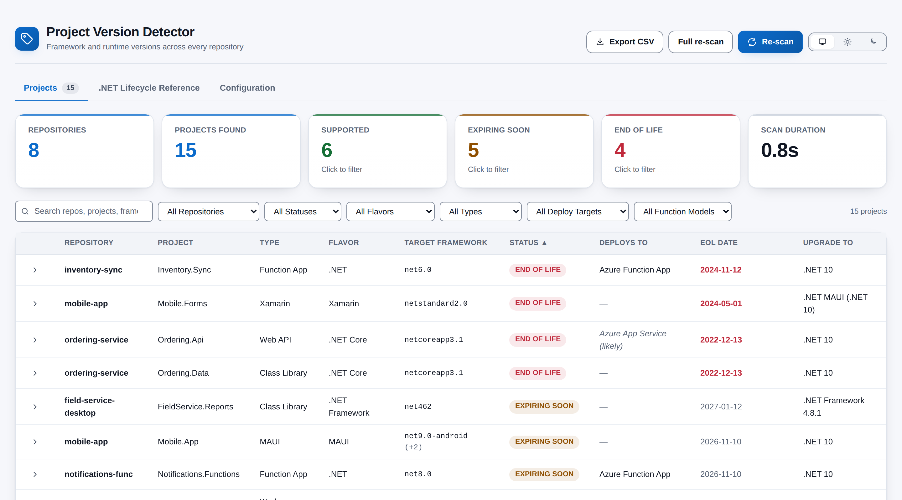
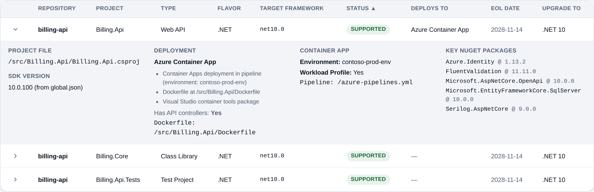

# Project Version Detector

**Know which of your .NET projects are out of support, before it becomes urgent.** Project Version Detector scans every Git repository in your Azure DevOps project, finds each .NET project and the framework it targets, and checks it against Microsoft's lifecycle dates. In a minute or two you get one table listing every project in every repository, with the frameworks that have reached end of life or will within six months at the top and a recommended upgrade target beside each one. It lives under **Repos > Version Detector** and runs entirely in your browser.

## What you get

- **A lifecycle status for every project.** Each project is marked **End of Life**, **Expiring Soon**, **Supported** or **Preview**, with its end-of-life date. Statuses are worked out from today's date, so a framework moves to Expiring Soon or End of Life on its own, with no new commit needed.
- **Upgrade advice.** Modern .NET and .NET Core projects point to .NET 10, .NET Framework projects to 4.8.1, and Xamarin projects to .NET MAUI.
- **Every flavour of .NET.** Covers modern .NET (5 to 10), .NET Core, .NET Framework (including legacy project files), .NET Standard, MAUI and Xamarin. Projects that inherit their target framework from a `Directory.Build.props` are found too.
- **Project types.** Web App, Web API, Blazor, Worker Service, Console, Function App, WPF, WinForms, class libraries and test projects. Central Package Management references are understood.
- **Where each app deploys.** Azure App Service, Container Apps, Functions, Static Web Apps or Kubernetes. The verdict comes from your pipeline tasks and project shape, is marked as confirmed or *likely*, and comes with the evidence behind it.
- **Azure Functions and Container Apps details.** Shows the hosting model (isolated worker or in-process) and runtime, and the Container Apps environment and workload profile found in your pipeline YAML, including referenced templates.
- **Key NuGet packages** such as ASP.NET Core, Entity Framework Core, Azure SDKs, Serilog and Polly, with their versions.
- **Fast re-scans.** Repositories with no new commits since your last scan are reused instantly. **Full re-scan** is there when you want everything fresh.
- **Filter, search and export.** Click a summary tile to filter by status, search across repositories, projects, frameworks and packages, narrow by repository, flavour, type, deploy target or Functions model, and export what you see to CSV.
- **Your own lifecycle dates.** The Configuration tab lets you adjust dates, add new versions as Microsoft announces them, or remove entries, for the whole organization. Destructive changes ask for confirmation first.
- **Looks at home in Azure DevOps.** Follows your Azure DevOps light, dark or high-contrast theme automatically, with an optional light/dark override. Colours meet WCAG 2.1 AA contrast, and status is always written out as text, never shown by colour alone.

## How it works

1. Open **Repos > Version Detector** in any project.
2. The extension lists the project's repositories and reads each one's file tree, then reads only the files it needs: project files, `global.json`, `Directory.Build.props`, Functions settings and pipeline YAML.
3. It works out each project's framework, type and deployment target, and matches the framework to the lifecycle data.
4. Results appear in a sortable table with summary tiles. Expand any row for the project file, SDK version, deployment evidence and key packages.
5. Your result is saved for you, so the next visit opens instantly and only re-checks repositories that have changed.

## Permissions

- **Code (read)** is needed to list repositories and read the project, configuration and pipeline files in them. The extension never changes your code, and you can only scan repositories you can already see.
- **Extension data (read and write)** is needed to save your last scan result, which only you can see, and the organization's lifecycle settings.

## Privacy

Everything happens in your browser using your own Azure DevOps session. Scan results and lifecycle settings are stored in your organization's Azure DevOps extension data storage, and no file contents are stored. There is no telemetry, no analytics and no third-party service. The extension talks only to your Azure DevOps organization.

## Support

Found a problem or have an idea? Please open an issue on [GitHub Issues](https://github.com/adam-wheater/azure-devops-project-version-detector/issues).

## License

Copyright © 2026 Adam Wheater. All rights reserved. This software is provided under a proprietary source-available license: you may read and audit the code and use the published extension, but you may not copy, modify, redistribute or republish it. See the LICENSE file for the full terms. The open source components it bundles keep their own licenses, listed in THIRD-PARTY-NOTICES.txt inside the package.
